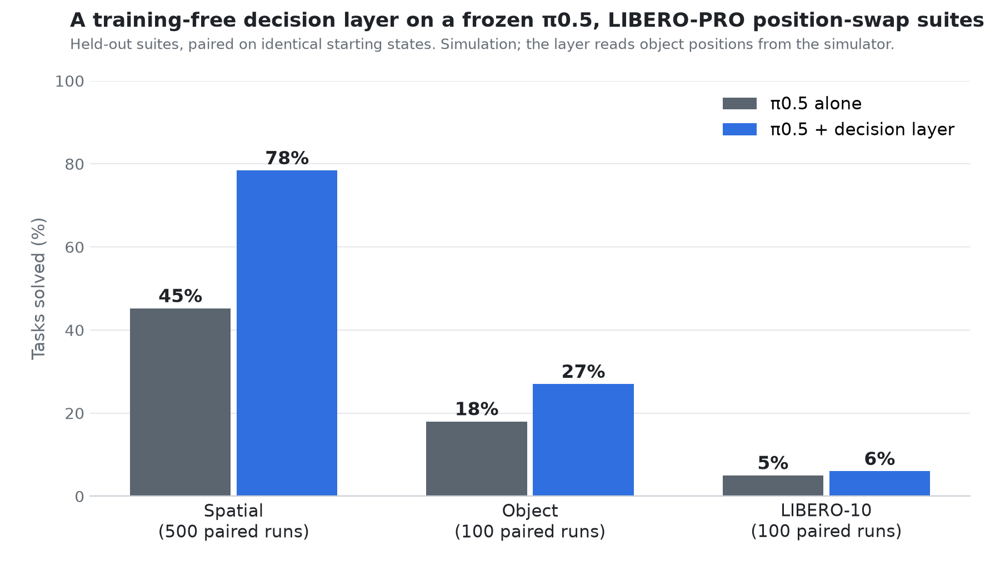
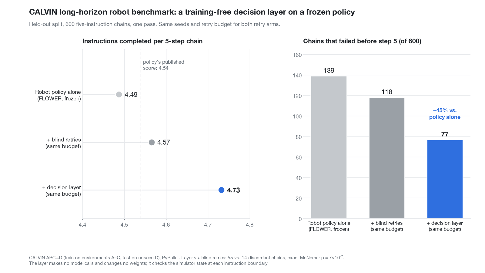

# Decision layers around frozen robot policies

Two experiments that ask the same question: **can a small, training-free decision layer make a frozen
robot policy more reliable, measured against a matched control on held-out data?**

In both, the policy's weights are never touched. The layer sits between the task instruction and the
policy, reads the state of the simulator, and decides what the policy should be asked to do next, or
takes over for a short scripted motion.

| Experiment | Frozen policy | Benchmark | Policy alone | With layer | Paired test |
|---|---|---|---|---|---|
| [`libero_pro_pi05/`](libero_pro_pi05) | π0.5 (`pi05_libero`, Physical Intelligence, openpi) | LIBERO-PRO position swap, spatial suite, 500 paired episodes | 45.2% | **78.4%** | 185 wins / 19 losses, p = 2e-35 |
| | | LIBERO-PRO position swap, 3 held-out suites pooled, 300 paired episodes (pre-registered) | 23.3% | **36.7%** | 46 wins / 6 losses, p = 1e-8 |
| [`calvin_flower/`](calvin_flower) | FLOWER (`mbreuss/flower_calvin_abc`) | CALVIN ABC→D, 600 held-out chains | 4.49 of 5 | **4.73 of 5** | vs matched blind-retry control (4.57): 55 wins / 14 losses, p = 7e-7 |





Side-by-side replays: [`assets/pi05_layer_side_by_side.mp4`](assets/pi05_layer_side_by_side.mp4), [`assets/calvin_chain57_side_by_side.mp4`](assets/calvin_chain57_side_by_side.mp4).

All p-values are exact two-sided McNemar tests on paired episodes (same task, same starting state).

## What these results are, and are not

- **Simulation only.** Nothing here ran on a physical robot.
- **The layers read privileged simulator state.** The LIBERO-PRO layer reads object and fixture
  positions; the CALVIN layer reads contact and joint state. On a real robot that information would
  have to come from perception, which is not solved here.
- **The LIBERO-PRO layer scripts part of the motion.** After π0.5 has grasped the object, the layer
  carries it to the destination's actual position and, for movable destinations, lowers and releases it.
  π0.5 does the grasp and everything else.
- **Tuning data is excluded from every claim.** Each experiment fixed a development split first, froze
  the layer, and then ran the held-out data once.
- **These are wrappers, not better models.** Neither result says anything negative about the wrapped
  policy's authors. The policies are strong; the layers address one failure pattern each.
- **Absolute levels stay modest on LIBERO-PRO.** 36.7% pooled is far below π0.5's ~97% on unperturbed
  LIBERO. The claim is that the layer recovers a significant share of the position-swap loss.

## Layout

```
libero_pro_pi05/   code, per-episode results, working journal with the pre-registration
calvin_flower/     code, per-chain results, protocol and final table
```

Each folder has its own README with the method, the full tables, and how to reproduce.

## Third-party components (not redistributed here)

- openpi and the `pi05_libero` checkpoint: https://github.com/Physical-Intelligence/openpi
- LIBERO-PRO benchmark and files: https://github.com/Zxy-MLlab/LIBERO-PRO (arXiv 2510.03827)
- LIBERO: https://github.com/Lifelong-Robot-Learning/LIBERO
- CALVIN: https://github.com/mees/calvin
- FLOWER VLA: https://github.com/intuitive-robots/flower_vla_calvin (arXiv 2509.04996)

## License

No license file has been added yet, so default copyright applies to the code in this repository.
The third-party projects above keep their own licenses.
